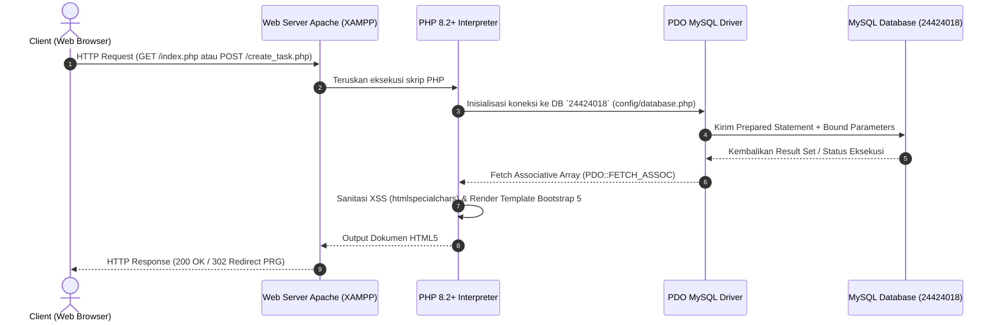
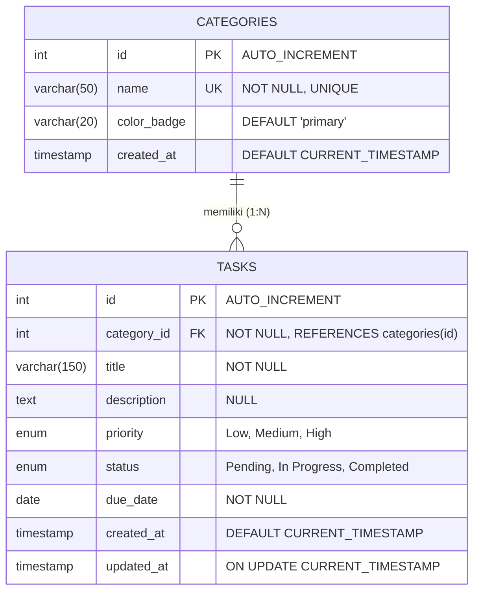

# TUTOR.md — Dokumentasi Akademis, Arsitektur, ERD, & Panduan Menjalankan di Localhost (XAMPP) & InfinityFree
**Aplikasi:** TaskFlow - Relational To-Do List Web App  
**Nama Database:** `24424018`  
**Mata Kuliah:** Pemrograman Web Database  
**Dibuat oleh:** Dedy Harisman  

---

## 1. Arsitektur Web Database & Alur Client-Server (Sub-CPMK 1)

Aplikasi **TaskFlow** dibangun menggunakan arsitektur **Client-Server 3-Tier** (*Presentation Layer*, *Application/Business Logic Layer*, dan *Data Persistence Layer*). Setiap permintaan pengguna (*HTTP Request*) diproses secara sistematis mulai dari peramban (*Web Browser*) menuju *Web Server* Apache (XAMPP/Localhost), dieksekusi oleh PHP, lalu berkomunikasi ke MySQL/MariaDB pada database **`24424018`** menggunakan driver PDO.

### Diagram Alur Request-Response (Mermaid Sequence Diagram)



### Penjelasan Tahapan Alur Client-Server:
1. **HTTP Request (Client / Browser):** Pengguna mengakses halaman (misalnya `GET index.php`) atau mengirimkan formulir tambah/ubah tugas (`POST create_task.php`).
2. **Web Server (Apache di XAMPP):** Menerima paket HTTP pada `localhost`, memetakan URL ke file fisik di dalam direktori `C:\xampp\htdocs\`, lalu meneruskannya ke modul PHP.
3. **PHP Interpreter:** Mengeksekusi logika bisnis aplikasi, memvalidasi input *server-side*, mengelola sesi (*Flash Message*), dan memanggil konfigurasi basis data (`config/database.php`).
4. **PDO Driver (`pdo_mysql`):** Menjalankan komunikasi ke basis data **`24424018`** menggunakan **Native Prepared Statements** (`PDO::ATTR_EMULATE_PREPARES => false`) sehingga parameter input pengguna dipisahkan dari struktur perintah SQL untuk mencegah *SQL Injection*.
5. **MySQL / MariaDB Server:** Mengeksekusi query (`SELECT ... INNER JOIN`, `INSERT`, `UPDATE`, `DELETE`), menjaga integritas referensial (*Foreign Key*), dan mengembalikan hasil ke PDO.
6. **HTML Response:** PHP menyusun hasil data ke dalam tabel dinamis Bootstrap 5 dengan membungkus seluruh data menggunakan `htmlspecialchars($str, ENT_QUOTES, 'UTF-8')` guna mencegah serangan *Cross-Site Scripting* (XSS), lalu Apache mengirimkannya kembali ke browser pengguna.

---

## 2. Perancangan Skema Database `24424018`, Normalisasi & ERD (Sub-CPMK 2)

### A. Analisis Normalisasi (1NF, 2NF, 3NF)
Skema database **`24424018`** telah memenuhi kaidah normalisasi hingga **Bentuk Normal Ketiga (3NF)**:
- **First Normal Form (1NF):** Setiap atribut pada tabel `categories` dan `tasks` bernilai atomik (tidak ada kolom bernilai ganda/multivalued atau grup berulang), serta setiap baris diidentifikasi secara unik oleh *Primary Key* (`id`).
- **Second Normal Form (2NF):** Telah memenuhi 1NF dan seluruh atribut non-kunci memiliki ketergantungan fungsional penuh (*full functional dependency*) terhadap *Primary Key* masing-masing tabel.
- **Third Normal Form (3NF):** Telah memenuhi 2NF dan tidak terdapat ketergantungan transitif (*transitive dependency*). Atribut nama kategori (`name`) dan warna label (`color_badge`) dipisahkan ke tabel master `categories`, sehingga tabel `tasks` cukup menyimpan *Foreign Key* `category_id`.

### B. Entity-Relationship Diagram (Mermaid ERD)



### C. Diagram ERD Teks (ASCII)
```text
Database: 24424018
+-----------------------------------+          +---------------------------------------------+
|            categories             |          |                    tasks                    |
+-----------------------------------+          +---------------------------------------------+
| PK  id          INT AUTO_INCREMENT| 1      N | PK  id          INT AUTO_INCREMENT          |
| UK  name        VARCHAR(50)       |----------| FK  category_id INT (ON DELETE RESTRICT)    |
|     color_badge VARCHAR(20)       |          |     title       VARCHAR(150)                |
|     created_at  TIMESTAMP         |          |     description TEXT                        |
+-----------------------------------+          |     priority    ENUM('Low','Medium','High') |
                                               |     status      ENUM('Pending','In Progress'|
                                               |                      ,'Completed')          |
                                               |     due_date    DATE                        |
                                               |     created_at  TIMESTAMP                   |
                                               |     updated_at  TIMESTAMP                   |
                                               +---------------------------------------------+
```

---

## 3. Pemetaan Kode terhadap Indikator Sub-CPMK 1 s.d. 7

| Sub-CPMK | Indikator Capaian Pembelajaran | File Implementasi |
| :--- | :--- | :--- |
| **Sub-CPMK 1** | Arsitektur Web Database & Struktur Direktori Localhost (`htdocs`) | `TUTOR.md`, Struktur Direktori Root |
| **Sub-CPMK 2** | Perancangan Skema Database `24424018` Berelasi & Normalisasi 3NF | `database/schema.sql`, `TUTOR.md` |
| **Sub-CPMK 3** | Konektivitas Database PDO (`24424018`), `ERRMODE_EXCEPTION`, & Indikator Koneksi | `config/database.php`, `includes/header.php`, `includes/footer.php` |
| **Sub-CPMK 4** | Fitur **Create** (Form Tugas & Kategori, Validasi Server-Side, Prepared Statements) | `index.php`, `create_task.php`, `create_category.php` |
| **Sub-CPMK 5** | Fitur **Read** (Tabel Dinamis `INNER JOIN`, Filter GET, Pengurutan Logis `ORDER BY`) | `index.php` |
| **Sub-CPMK 6** | Fitur **Update** (Form Pre-filling `edit.php?id=`, Update PDO, & Quick Toggle Status) | `edit.php`, `toggle_status.php` |
| **Sub-CPMK 7** | Fitur **Delete** (Konfirmasi JS `confirm()`, Delete PDO, & Session Flash Message) | `delete.php`, `index.php`, `includes/header.php` |

---

## 4. Panduan Menjalankan Aplikasi di Localhost (XAMPP / Laragon) Tanpa Docker

Konfigurasi di `config/database.php` sudah diatur langsung untuk terhubung ke database **`24424018`** di `127.0.0.1` (`localhost`) dengan user `root` dan password kosong `""`.

### Langkah-langkah Menjalankan di XAMPP:
1. **Salin Folder Proyek ke `htdocs`:**
   - Salin folder proyek `utsphpdedyharisman` ke dalam direktori `C:\xampp\htdocs\` (sehingga lokasinya menjadi `C:\xampp\htdocs\utsphpdedyharisman`).
2. **Nyalakan Apache & MySQL:**
   - Buka **XAMPP Control Panel**, lalu klik tombol **Start** pada modul **Apache** dan **MySQL** hingga keduanya berwarna hijau.
3. **Import File SQL (`database/schema.sql`):**
   - Buka browser dan akses **phpMyAdmin** di alamat: `http://localhost/phpmyadmin`
   - Klik menu **Import** di bagian atas (tanpa perlu membuat database manual terlebih dahulu karena di dalam `schema.sql` sudah terdapat perintah `CREATE DATABASE IF NOT EXISTS \`24424018\`; USE \`24424018\`;`).
   - Klik **Choose File**, pilih file `database/schema.sql` dari dalam folder proyek Anda, lalu klik tombol **Import / Go** di bagian bawah.
   - Database **`24424018`** beserta tabel `categories`, tabel `tasks`, dan *seed data* awal akan otomatis terbuat.
4. **Buka Aplikasi di Browser:**
   - Akses alamat: `http://localhost/utsphpdedyharisman/`
   - Pastikan indikator di kanan atas dan footer menampilkan badge hijau **"Database Connected"**.

---

## 5. Panduan Deploy Mandiri ke InfinityFree (Shared Cloud Hosting Gratis)

Struktur proyek ini dirancang *flat-friendly* (tanpa Composer/Node.js) agar 100% kompatibel dengan direktori `htdocs/` pada **InfinityFree**.

### Langkah 1: Buat Database MySQL di InfinityFree
1. Login ke dashboard [InfinityFree](https://www.infinityfree.com/) dan buka **Control Panel (VistaPanel)** pada akun hosting Anda.
2. Masuk ke menu **MySQL Databases**.
3. Pada bagian **Create New Database**, ketik **`24424018`** lalu klik **Create Database**.
4. Catat 4 informasi penting yang tertera di bagian **MySQL Details**:
   - **MySQL Hostname:** (contoh: `sql210.infinityfree.com`)
   - **MySQL Database Name:** (contoh: `if0_37123456_24424018`)
   - **MySQL Username:** (contoh: `if0_37123456`)
   - **MySQL Password:** (password akun hosting Anda)

### Langkah 2: Import Tabel & Seed Data (`database/schema.sql`)
1. Masih di halaman **MySQL Databases** VistaPanel, klik tombol **Admin / phpMyAdmin** di samping database `if0_XXXXXXX_24424018` Anda.
2. Sebelum mengimpor ke InfinityFree, hapus atau beri komentar `--` pada baris `CREATE DATABASE` dan `USE \`24424018\`;` di dalam file `database/schema.sql` (karena di shared hosting nama databasenya memiliki prefix `if0_XXXXXXX_`).
3. Klik tab **Import**, pilih file `database/schema.sql`, lalu klik **Go / Kirim**.

### Langkah 3: Sesuaikan Konfigurasi `config/database.php`
1. Buka file `config/database.php`.
2. Pada bagian **B. KONFIGURASI KHUSUS DEPLOYMENT INFINITYFREE**, hapus tanda komentar (`//`) dan isi dengan kredensial database InfinityFree Anda:
   ```php
   $db_host = 'sql210.infinityfree.com';        // Ganti dengan MySQL Hostname Anda
   $db_name = 'if0_37123456_24424018';          // Ganti dengan MySQL Database Name Anda
   $db_user = 'if0_37123456';                   // Ganti dengan MySQL Username Anda
   $db_pass = 'password_hosting_anda';          // Ganti dengan MySQL Password Anda
   ```

### Langkah 4: Unggah Seluruh File ke Direktori `htdocs/`
1. Buka **Online File Manager** dari dashboard InfinityFree (atau gunakan **FileZilla**).
2. Masuk ke dalam folder **`htdocs/`** dan unggah seluruh file serta folder proyek (`config/`, `includes/`, `index.php`, `create_task.php`, `create_category.php`, `edit.php`, `toggle_status.php`, `delete.php`).
3. Buka domain website InfinityFree Anda di browser.

---
*Dibuat oleh **Dedy Harisman** — Proyek Pemrograman Web Database (Database: `24424018`)*
